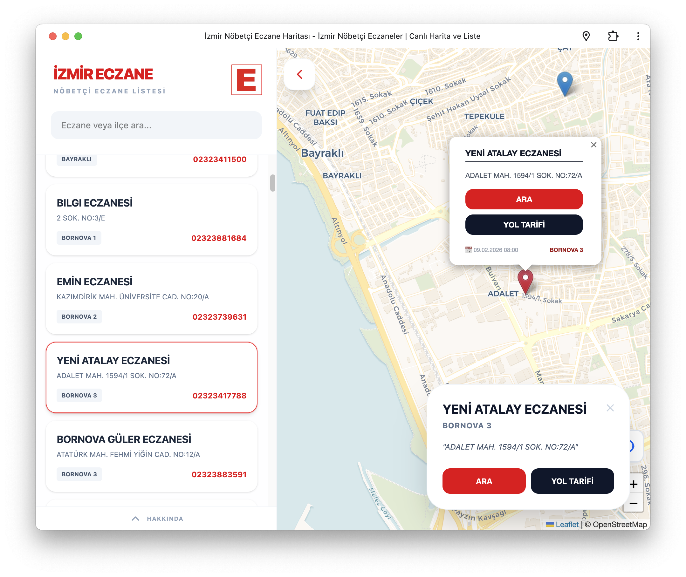
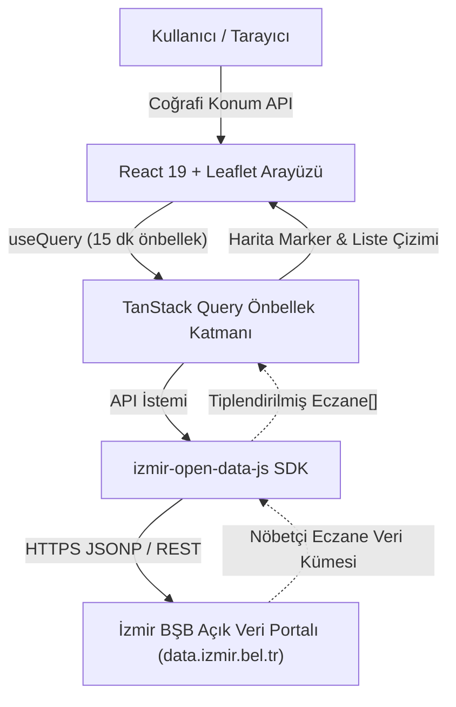
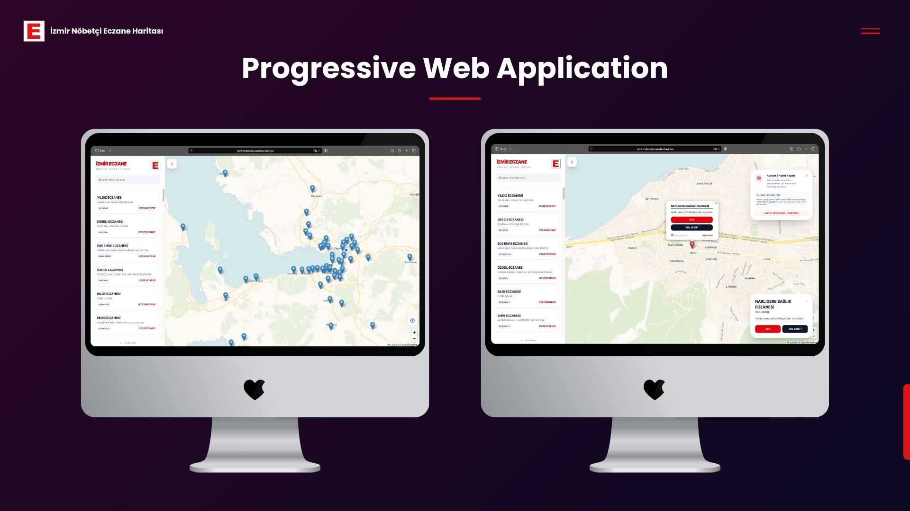

<div align="center">
  

  # İzmir Nöbetçi Eczane Haritası

  **İzmir genelindeki nöbetçi eczaneleri ilçe idari sınırlarına bağlı kalmaksızın kullanıcı konumuna göre harita üzerinde sunan Progressive Web App (PWA).**

  <p align="center">
    <a href="https://github.com/AtaCanYmc/izmir-nobetci-eczane-haritasi/actions/workflows/ci.yml"></a>
    <a href="https://github.com/AtaCanYmc/izmir-nobetci-eczane-haritasi/actions/workflows/deploy.yml"></a>
    <a href="LICENSE"></a>
    
    
    
    
  </p>
</div>

---

<p align="center">
  
</p>

## İçindekiler

- [Genel Bakış](#genel-bakış)
- [Sistem Mimarisi](#sistem-mimarisi)
- [Temel Yetenekler](#temel-yetenekler)
- [Kurulum ve Hızlı Başlangıç](#kurulum-ve-hızlı-başlangıç)
- [Proje Dizin Yapısı](#proje-dizin-yapısı)
- [SDK Entegrasyonu](#sdk-entegrasyonu)
- [Teknik SSS](#teknik-sss)
- [Katkıda Bulunma ve Yönetişim](#katkıda-bulunma-ve-yönetişim)
- [Lisans](#lisans)

---

## Genel Bakış

Geleneksel nöbetçi eczane listeleri kullanıcıyı belirli bir ilçe seçmeye zorlar. Bayraklı ve Bornova veya Karşıyaka ve Çiğli gibi idari sınırların iç içe geçtiği bölgelerde ilçe bazlı sorgular kullanıcıya en yakın eczaneyi göstermeyebilir.

Bu proje, İzmir Büyükşehir Belediyesi Açık Veri Portalı üzerinde yayımlanan nöbetçi eczane veri akışını `izmir-open-data-js` SDK'sı üzerinden alır. Tüm nöbetçi eczaneleri tek bir koordinat düzleminde birleştirir. Kullanıcı konumuna göre en yakın sağlık noktalarına doğrudan erişim sağlar.

Canlı Sürüm: [izmirnobetcieczaneharitasi.live](https://izmirnobetcieczaneharitasi.live)

---

## Sistem Mimarisi

Uygulama istemci tarafında çalışan tek sayfalık bir web uygulamasıdır. Veri akışı ve durum yönetimi aşağıdaki katmanlar üzerinden yürütülür:



---

## Temel Yetenekler

- **Konum Odaklı Harita:** Leaflet ve React-Leaflet motoru ile kullanıcının mevcut konumunu tespit eder ve çevresindeki nöbetçi eczaneleri mesafeye göre listeler.
- **Akıllı Önbellek Yönetimi:** TanStack Query ile eczane verileri 15 dakika boyunca istemci belleğinde tutulur. Gereksiz ağ istekleri önlenir.
- **Dinamik Harita Temaları:** Harita katmanı açık ve karanlık mod ile senkronize çalışır. Varsayılan olarak API anahtarı gerektirmeyen OpenStreetMap kullanılır; isteğe bağlı olarak CARTO API anahtarı (`VITE_CARTO_API_KEY`) ile CARTO Voyager ve Dark Matter katmanları da etkinleştirilebilir.
- **Çoklu Dışa Aktarım (Export):** Aktif harita alanını PNG görseli olarak kaydedebilir; nöbetçi eczane listesini JSON, CSV, GeoJSON veya bağımsız çalışan statik HTML formatında indirebilirsiniz.
- **Progressive Web App (PWA):** Servis işçisi (Service Worker) altyapısı sayesinde mobil ve masaüstü tarayıcılarda ana ekrana yüklenebilir ve uygulama gibi çalışır.

<p align="center">
  
</p>

---

## Kurulum ve Hızlı Başlangıç

### Gereksinimler
- Node.js 20.x veya daha güncel sürüm
- npm 10.x veya daha güncel sürüm

### Adımlar

1. Depoyu yerel makinenize klonlayın:
   ```bash
   git clone https://github.com/AtaCanYmc/izmir-nobetci-eczane-haritasi.git
   cd izmir-nobetci-eczane-haritasi
   ```

2. Bağımlılıkları yükleyin:
   ```bash
   npm install
   ```
   *Not: Depoda yer alan `.npmrc` yapılandırması bağımlılık çözümleme uyarılarını otomatik olarak yönetir.*

3. (İsteğe Bağlı) Ortam değişkenlerini yapılandırın:
   ```bash
   cp .env.example .env
   ```

4. Geliştirme sunucusunu başlatın:
   ```bash
   npm run dev
   ```
   Yerel adres: `http://localhost:5173`

5. Üretim paketi derleme ve doğrulama:
   ```bash
   npm run type-check
   npm run build
   ```

### Ortam Değişkenleri

| Değişken | Tür | Varsayılan | Zorunlu | Açıklama |
| :--- | :--- | :--- | :---: | :--- |
| `VITE_CARTO_API_KEY` | String | *(Boş)* | Hayır | CARTO Basemaps API anahtarı. Boş bırakıldığında harita doğrudan açık kaynak OpenStreetMap katmanını kullanır. |

---

## Proje Dizin Yapısı

```text
.
├── .github/
│   ├── ISSUE_TEMPLATE/          # Hata ve öneri formları
│   ├── PULL_REQUEST_TEMPLATE/   # PR doğrulama şablonu
│   └── workflows/
│       ├── ci.yml               # Otomatik tip ve link denetimi
│       ├── deploy.yml           # GitHub Pages yayınlama hattı
│       └── release-please.yml   # Otomatik sürüm ve changelog yayını
├── docs/
│   └── images/                  # Belgelendirme ekran görüntüleri
├── public/                      # Web manifest ve statik PWA varlıkları
├── src/
│   ├── assets/                  # Logo ve vektörel kaynaklar
│   ├── components/              # Yeniden kullanılabilir arayüz parçaları
│   │   ├── footer/              # Alt bilgi bileşeni
│   │   └── map/                 # Leaflet harita katmanları ve marker kontrolleri
│   ├── contexts/                # Tema durum sağlayıcısı (ThemeContext)
│   ├── hooks/                   # Özel kancalar (useAnalytics)
│   ├── pages/
│   │   └── pharmacy/            # Ana sayfa ve eczane listeleme mantığı
│   ├── services/                # izmir-open-data-js SDK entegrasyonu
│   ├── types/                   # TypeScript veri arayüzleri
│   └── utils/                   # Tarih ve dışa aktarım yardımcı fonksiyonları
├── .editorconfig                # Evrensel düzenleyici kuralları
├── .env.example                 # Ortam değişkenleri şablonu
├── .gitattributes               # Çapraz platform satır sonu denetimi
├── .gitignore                   # Git takip dışı dosyalar listesi
├── .markdownlint.json           # Dokümantasyon biçim kuralları
├── .npmrc                       # Paket yöneticisi kuralları
├── .release-please-manifest.json # Release Please sürüm takibi
├── CONTRIBUTING.md              # Katkıda bulunma rehberi
├── LICENSE                      # Apache 2.0 lisans metni
├── Makefile                     # Geliştirme ve derleme komutları
├── package.json                 # Bağımlılıklar ve npm scriptleri
├── README.md                    # Proje ana belgelendirmesi
├── release-please-config.json   # Release Please yapılandırması
├── ROADMAP.md                   # Sürüm ve geliştirme planı
├── SECURITY.md                  # Güvenlik politikası ve SLA
├── tsconfig.json                # TypeScript derleme ayarları
└── vite.config.ts               # Vite ve PWA eklenti yapılandırması
```

---

## SDK Entegrasyonu

Proje, İzmir Büyükşehir Belediyesi Açık Veri Portalı API çağrılarını yönetmek için `izmir-open-data-js` paketini kullanır.

```typescript
import { IzmirAPI } from "izmir-open-data-js";

const api = new IzmirAPI();

// İzmir genelindeki güncel nöbetçi eczaneleri çeker
const nobetciEczaneler = await api.eczaneler.getNobetciList();
console.log(`Aktif nöbetçi eczane sayısı: ${nobetciEczaneler.length}`);
```

---

## Teknik SSS

#### Veriler hangi kaynaktan ve hangi sıklıkla güncellenir?
Veriler İzmir Büyükşehir Belediyesi Açık Veri Portalı üzerinden anlık olarak çekilir. Nöbetçi listesi her gün saat 18:00 itibarıyla güncellenir. İstemci tarafında `TanStack Query` 15 dakikalık bir önbellek süresi uygular.

#### İnternet bağlantısı kesildiğinde uygulama çalışır mı?
PWA servis işçisi arayüz kabuğunu çevrimdışı önbelleğe alır. Kullanıcı daha önce yüklenmiş harita görüntüsünü ve indirilen statik HTML veya JSON verilerini internetsiz ortamda görüntüleyebilir.

#### Uygulama kullanıcı konumu veya çerez verisi toplar mı?
Kullanıcının kesin koordinatları yalnızca tarayıcı üzerinde en yakın eczaneyi hesaplamak için kullanılır. Sunucuya konum kaydı aktarılmaz. Analitik takibi gizlilik odaklı ve çerezsiz Plausible altyapısı üzerinden yürütülür.

---

## Katkıda Bulunma ve Yönetişim

Projeye katkı sunmak için lütfen [CONTRIBUTING.md](CONTRIBUTING.md) belgesini inceleyin. Topluluk standartları ve davranış kuralları için [CODE_OF_CONDUCT.md](CODE_OF_CONDUCT.md) belgesi geçerlidir. Değişiklik önerileri için [Pull Request Şablonu](.github/PULL_REQUEST_TEMPLATE/pull_request_template.md) ve hata bildirimleri için [Hata Raporu Şablonu](.github/ISSUE_TEMPLATE/bug_report.yml) kullanılmalıdır.

Güvenlik açıkları için [SECURITY.md](SECURITY.md) dosyasındaki özel bildirim kanallarını takip ediniz.

Gelecek sürüm hedefleri [ROADMAP.md](ROADMAP.md) dosyasında listelenmiştir.

---

## Lisans

Bu proje [Apache License 2.0](LICENSE) kapsamında açık kaynak olarak yayımlanmıştır.
